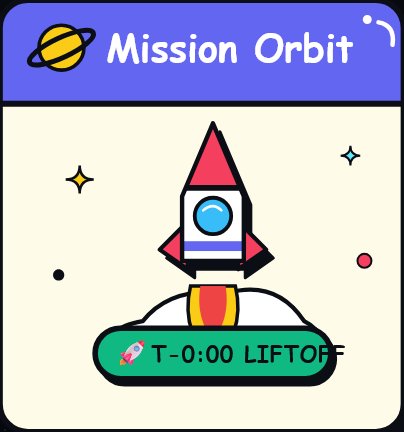
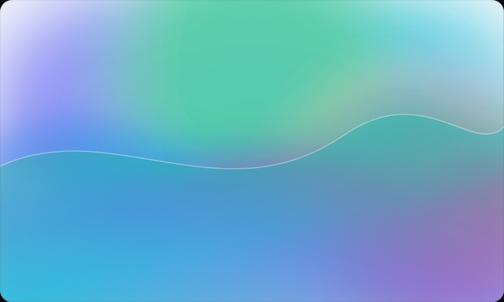
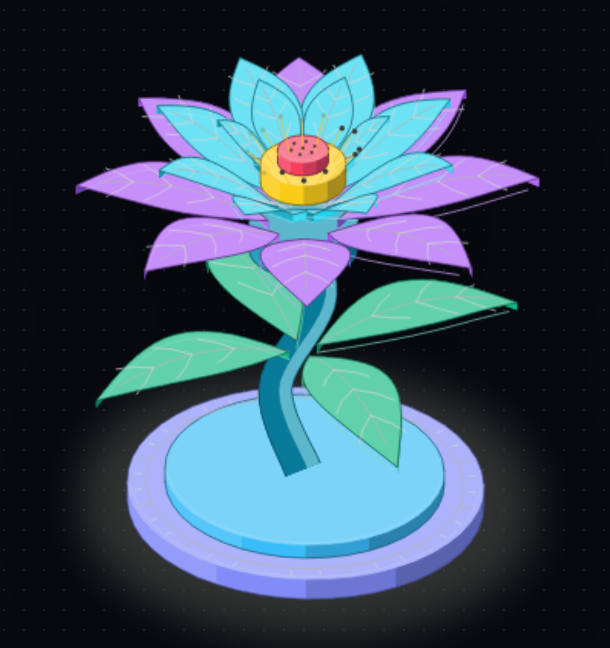

# 🎨 svg-3d-illustrator (V2 — 2D/3D Dual Engine, Color, Animations & Interactive Studio)

[](https://opensource.org/licenses/MIT)
[](https://nodejs.org/)
[](#supported-agent-platforms)

| 🤖 Astral Bot (Pop-Sticker UI) | 🚀 Cyber Rocket (Mission Orbit) |
| :---: | :---: |
|  |  |
| **2D Sticker & 3D Extruded** · Audio Waveform & Recordatorio<br>[🎛️ Open Studio ↗](./samples/astral-bot-card.html) | **2D & 3D Volumetric** · Vibrating Thruster Flames & Liftoff<br>[🎛️ Open Studio ↗](./samples/rocket-launch-card.html) |
| **🌌 Aurora Borealis (Fluid Mesh)** | **🌸 Bloom Flower (Organic 3D Botanical)** |
|  |  |
| **Atmospheric Background** · Smooth Bézier ribbons & diffuse glow<br>[🎛️ Open Studio ↗](./samples/aurora-light.html) | **3D Volumetric Botanical** · Veined petals, stamens & curved stem<br>[🎛️ Open Studio ↗](./samples/bloom-flower-color.html) |

**`svg-3d-illustrator`** is a deterministic **2D Flat & 3D Volumetric SVG illustration engine and Interactive Studio** built for AI coding agents (**Claude Code**, **Antigravity**, **Cursor**, **OpenCode**, **Codex**, **Windsurf**) and developers.

Outputting **100% pure, dependency-free, background-ready SVG code** with zero AI diffusion models (no DALL-E, no Midjourney). Everything is generated mathematically and deterministically.

---

## 🎨 Design Foundations: What Powers Our Visuals?

Our illustrations are designed under three distinct aesthetic pillars so technical projects never look like a generic gray box:

1. **Neo-Brutalist Pop-Sticker (`astral-bot-card`, `rocket-launch-card`, `retro-console-card`)**:
   - Heavy ink strokes (`4.4px`), smooth rounded corners, and **hard offset block shadows**.
   - Vibrant color palettes (electric blue, lavender, citrus yellow, mint green) with embedded pure CSS micro-animations (pulsing audio waveforms, thruster flames, beating 8-bit pixel hearts).
   - Instant live toggling between **2D Flat Sticker** and **3D Extruded Card** in the Studio.

2. **Mechanical Engineering & Physical Hardware (`engine-piston`, `server-blade`, `desk-computer`, `dial-indicator`)**:
   - Technical exploded views and millimeter-precise isometric projections.
   - Solids rendered with analytical 4-tone directional lighting, bevels, knurling, and soft contact drop shadows (`iso-halo`).

3. **Atmospheric Fluid Meshes (`abstract-aurora-bg`)**:
   - Ethereal background light ribbons flowing along cubic Bézier curves, multi-stop gradients, and seamless atmospheric glow without harsh box clipping.

---

## ✨ What's New in V2

1. **Interactive Vector & 3D Studio Editor (`--preview` / `studio`)**:
   - **Infinite Canvas Viewport**: Smooth Mouse Wheel Zoom (`25%` to `800%`), Drag-to-Pan, Fit-to-Screen, and interactive **3D Orbit / Tilt** with mouse drag.
   - **Live 2D ↔ 3D Dimension Switcher**: Toggle any illustration between **3D Volumetric Isometric** and **2D Flat Vector** in real time.
   - **Live Color ↔ Monochrome B&W Switcher**: Switch instantly between classic black-and-white (`light` paper / `dark` obsidian) and **6 analytical 4-tone color palettes** (`botanical`, `vibrant`, `cyber-neon`, `warm-craft`, `blueprint`, `gold-onyx`), plus live color pickers and stroke weight sliders.
   - **Background-Ready Toggle (`No Base Plate`)**: Strip away rectangular base plates with one click so illustrations float cleanly on any website background or hero section.
   - **One-Click Export**: Download the exact customized `.svg` or copy a ready-to-use React `<Illustration3D />` component.
2. **Organic & Botanical Geometry Engine (`src/engine/organic-kit.mjs`)**:
   - Create specific, curved, and organic illustrations like **flowers (`bloom-flower`)**, leaves with veins, curved stems, and custom extruded 2D polygons — never limited to boxy slabs.
3. **Embedded 2D & 3D Animations (`src/engine/animations.mjs`)**:
   - 8 built-in presets (`static`, `float`, `spin`, `pulse`, `wobble`, `swing`, `spin-float`, `bloom`) compiled directly into pure CSS `@keyframes` inside the SVG.

---

## 🚀 Quick Start & CLI Commands

```bash
# 1. Generate a 3D Full-Color Botanical Flower with 'bloom' animation & Studio Editor
node bin/svg-3d.mjs craft \
  --model bloom-flower \
  --mode 3d \
  --color-mode color \
  --palette botanical \
  --animate bloom \
  --out ./samples/bloom-flower.svg \
  --preview

# 2. Generate a 2D Flat Flower without base plate (Background-Ready)
node bin/svg-3d.mjs craft \
  --model bloom-flower \
  --mode 2d \
  --color-mode color \
  --no-plate \
  --out ./samples/bloom-flower-2d.svg \
  --preview

# 3. Generate the 1984 Vintage Computer in Warm Craft Color + Float Animation
node bin/svg-3d.mjs craft \
  --model desk-computer \
  --color-mode color \
  --palette warm-craft \
  --animate float \
  --out ./samples/computer-color.svg \
  --preview

# 4. Open ANY existing SVG inside the Interactive Studio Editor
node bin/svg-3d.mjs studio \
  --in ./example-for-this-chat/axis-topography-light.svg \
  --out ./example-for-this-chat/axis-topography-light.html
```

---

## 📦 Catalog Models (`craft`)

| Model | Type | Description |
| :--- | :--- | :--- |
| **`bloom-flower`** | Organic / Botanical | Multi-corolla lotus/rose flower with curved 3D/2D veined petals, curved stem, leaves, and golden stamens. |
| **`engine-piston`** | Mechanical Automotive | V8 Car Engine Piston & Crankshaft assembly with machined crown, 3 compression/oil rings, wrist pin, I-beam connecting rod & counterweights. |
| **`astral-bot-card`** | Neo-Brutalist UI Sticker | Pop-Sticker UI Window (`Astral Bot`) with thick ink strokes, hard offset block shadows, dove/bird avatar, voice-note waveform & reply pill (2D Sticker & 3D Extruded). |
| **`rocket-launch-card`** | Neo-Brutalist Pop Sticker | Cyber Rocket launch badge with stylized rocket, exhaust flame, puff smoke clouds, ringed planet & `[🚀 T-0:00 LIFTOFF]` badge (2D & 3D, Animated/Static). |
| **`retro-console-card`** | Neo-Brutalist Pop Sticker | Retro handheld console card with D-pad, candy buttons, glowing LCD screen with beating 8-bit heart & `[❤️ LEVEL UP!]` badge (2D & 3D, Animated/Static). |
| **`desk-computer`** | Vintage Hardware | 1984 all-in-one desktop computer with CRT terminal, floppy slot, coiled cord, and 58-key mechanical keyboard. |
| **`server-blade`** | Cloud Infrastructure | 1U enterprise server blade with 4x hot-swap bays, green PCB, copper/aluminum CPU heatsink fins, RAM DIMMs & SFP+ fiber. |
| **`sorting-desk`** | Craft Workstation | Turned-leg wooden sorting table with 8-bay hollow overhead cubbies, envelopes, and mechanical dial postal scale. |
| **`dial-indicator`** | Precision Metrology | Surface plate test rig with magnetic post, articulated clamp, radial dial gauge, and step gauge blocks. |

---

## 🧪 Running Verification Tests

```bash
node test/verify.test.js
node test/render-samples.js
```

---

## 🙏 Acknowledgments & Credits

- **[`wheresryan22/anatomy`](https://github.com/wheresryan22/anatomy)**: Direct credit to Ryan for the isometric geometric architecture and the 4-tone analytical vector shading model that served as the geometric foundation for `src/engine/iso-kit.mjs` and the physical precision models.

---

## 📄 License

MIT License — Open Standard for AI Agent Skills.
